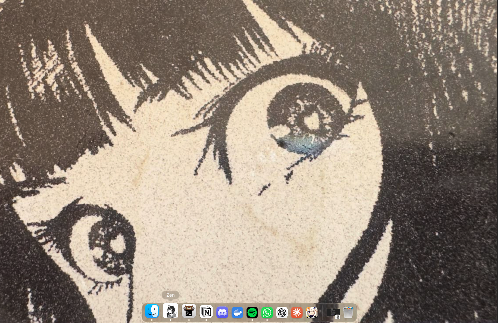
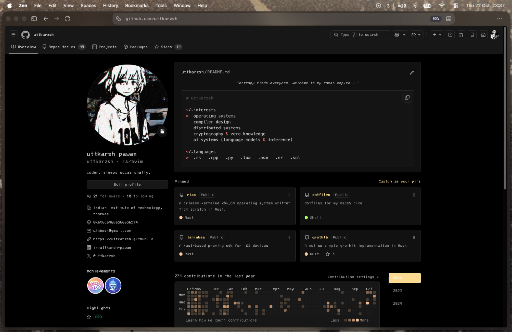
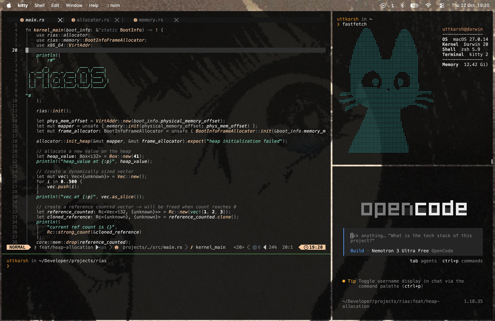
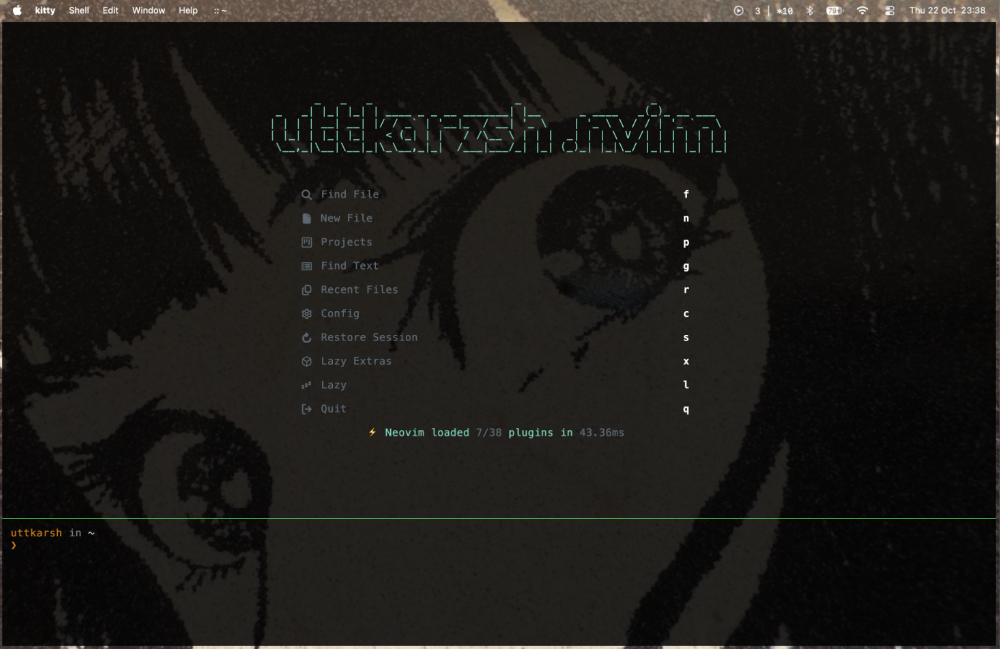

# macOS Rice

Minimal macOS setup built around a clean terminal workflow and keyboard-driven navigation.

## Preview

### Desktop + Browser

### Terminal + Neovim

## Setup

- WM: Aerospace
- Terminal: Kitty
- Editor: Neovim
- Browser: Zen Browser
- Shell: zsh
- Fetch: fastfetch
- Theme: Vesper 
- Font: JetBrainsMono Nerd Font
