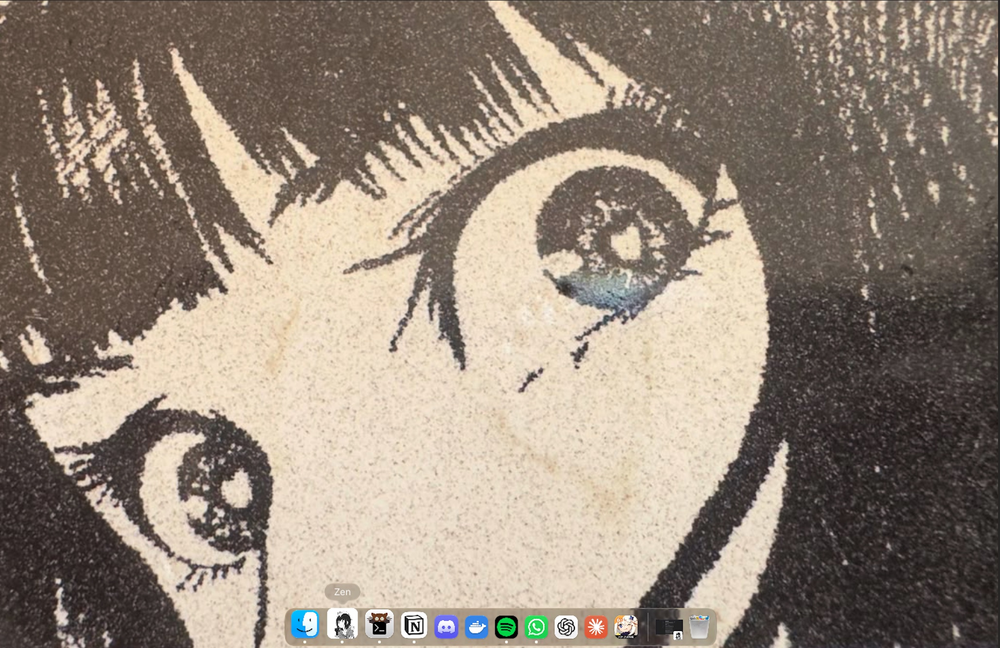
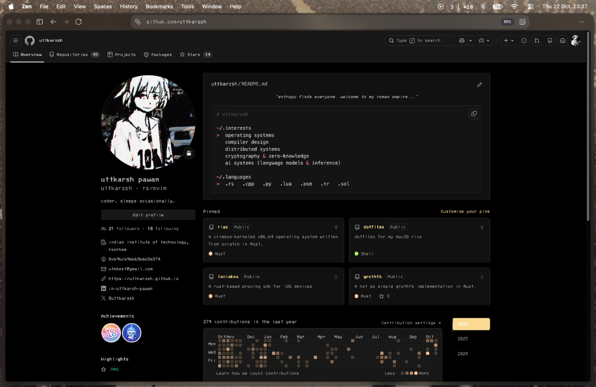
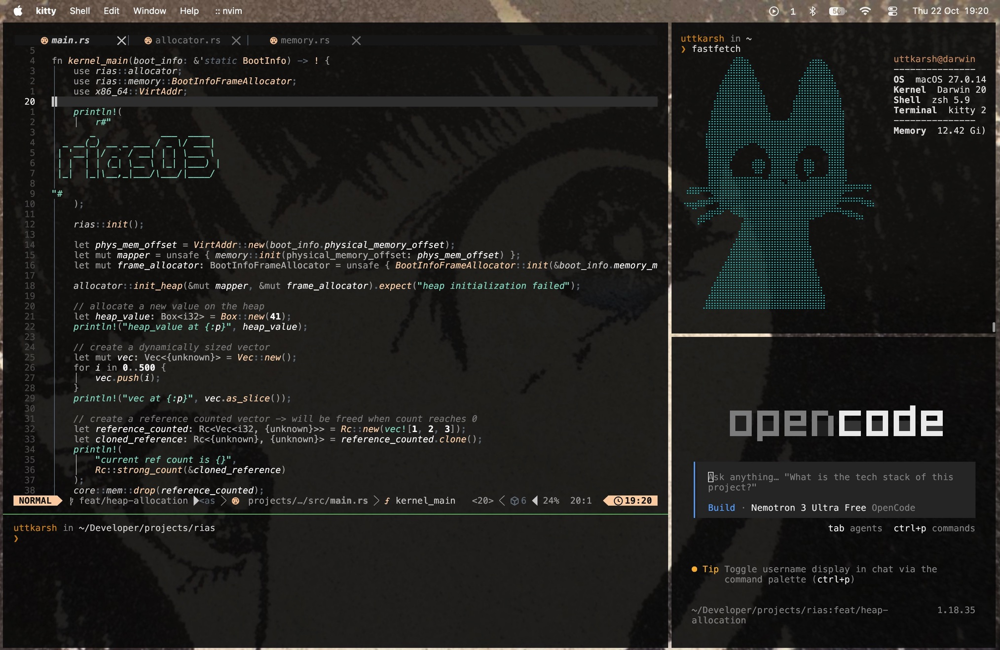
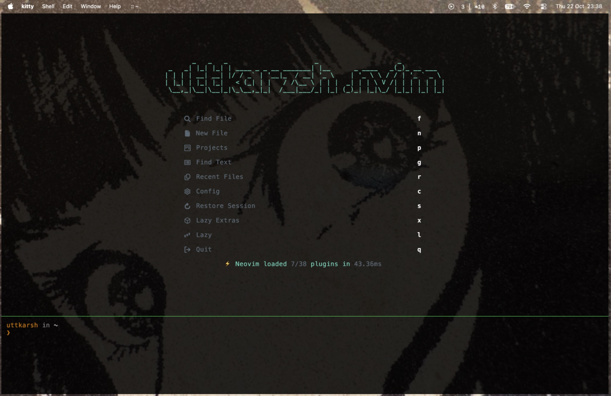

# macOS Rice

Minimal macOS setup built around a clean terminal workflow and keyboard-driven navigation.

## Preview

### Desktop + Browser




### Terminal + Neovim




## Setup

- WM: Aerospace
- Terminal: Kitty
- Editor: Neovim
- Browser: Zen Browser
- Shell: zsh
- Fetch: fastfetch
- Theme: Vesper
- Font: JetBrainsMono Nerd Font

## Install

Most folders in this repo are configs that live in `~/.config/<name>`.
`install.sh` symlinks them into place, so edits in the repo apply immediately:

| In repo      | Linked to               |
| ------------ | ----------------------- |
| `nvim/`      | `~/.config/nvim`        |
| `kitty/`     | `~/.config/kitty`       |
| `aerospace/` | `~/.config/aerospace`   |
| `fastfetch/` | `~/.config/fastfetch`   |
| `zsh/.zshrc` | `~/.zshrc`              |

```sh
git clone https://github.com/uttkarzsh/dotfiles.git ~/developer/dotfiles
cd ~/developer/dotfiles
./install.sh --dry-run   # preview what will happen
./install.sh
```

What it does:

- Creates the symlinks above. Anything already at those paths is moved to
  `<name>.backup.<timestamp>`, never deleted. Re-running is safe.
- Appends the zsh prompt (`user in ~/path` + `❯` on the next line) to
  `~/.zshrc`, once.
- Lists anything it expects but can't find (Neovim, ripgrep, fd, fastfetch,
  kitty, AeroSpace, JetBrainsMono Nerd Font). It doesn't install them; get
  them with Homebrew, e.g.
  `brew install neovim ripgrep fd fastfetch && brew install --cask kitty nikitabobko/tap/aerospace font-jetbrains-mono-nerd-font`.

Open `nvim` once afterwards and let lazy.nvim install the plugins.
